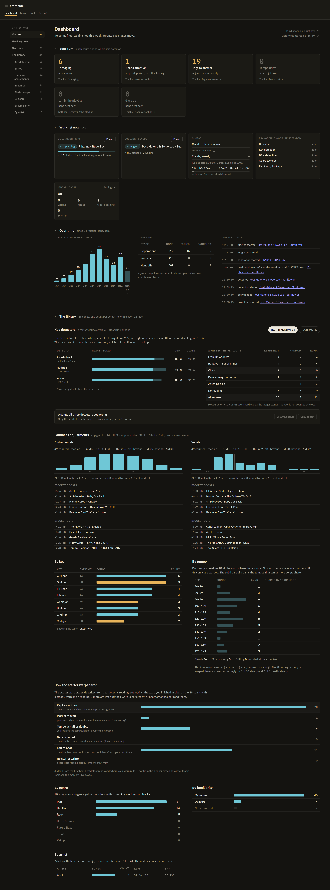
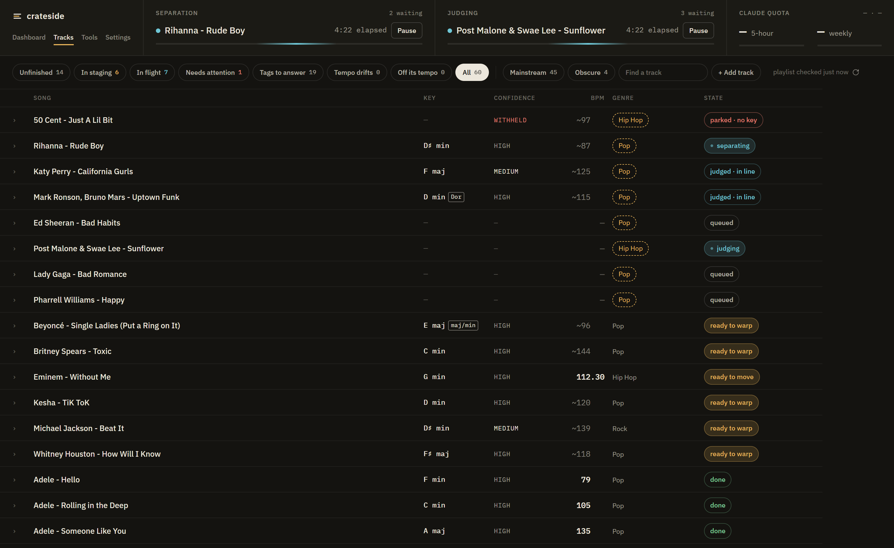
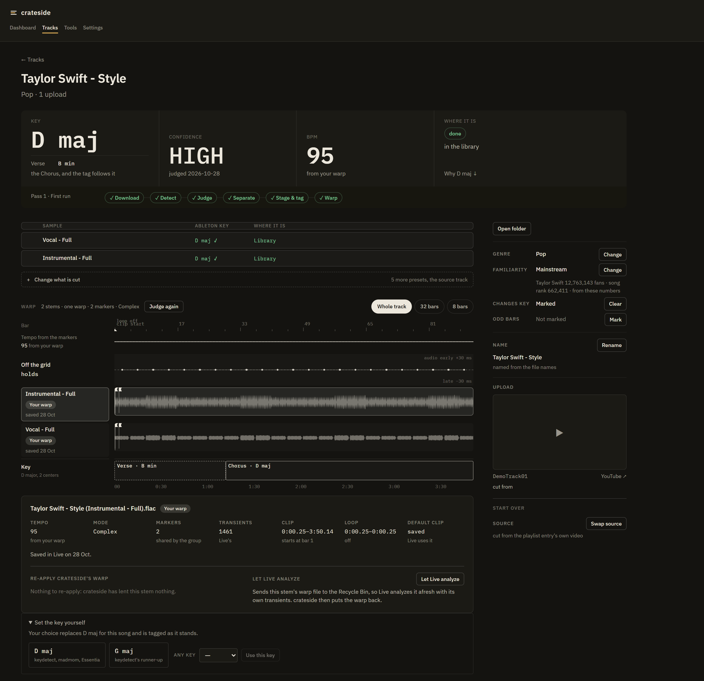
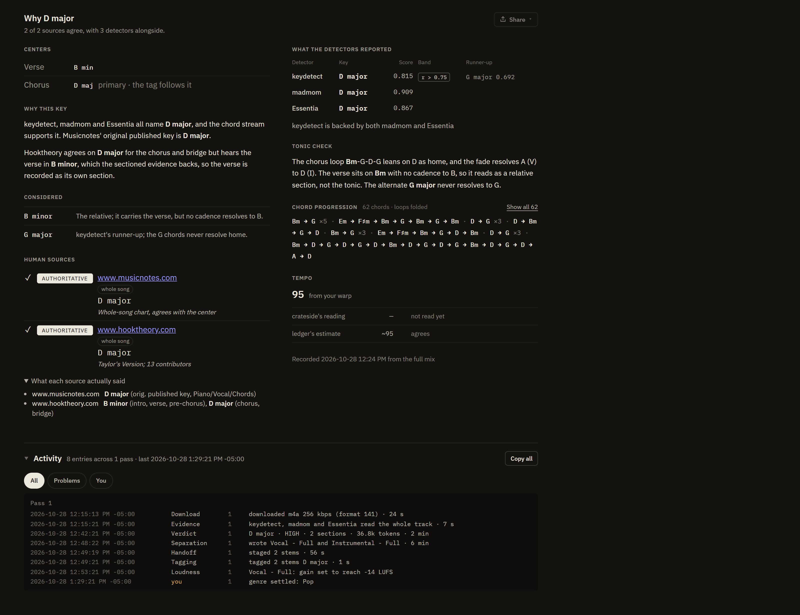
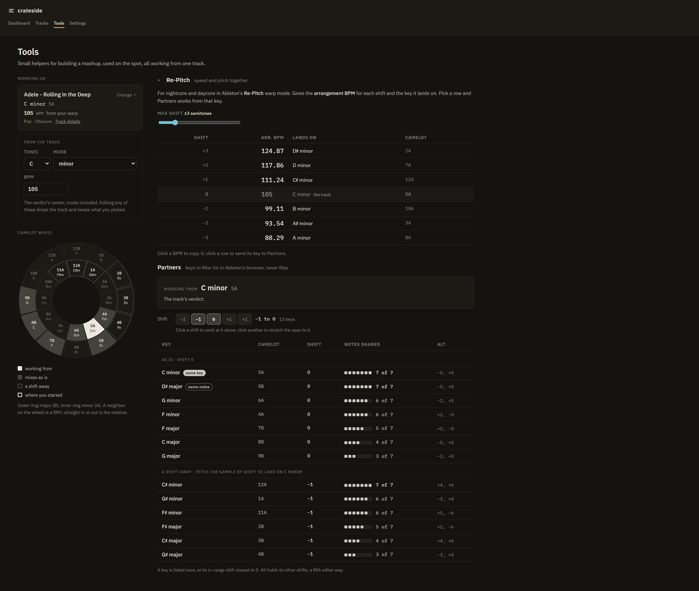

<p align="center">
  <picture>
    <source media="(prefers-color-scheme: dark)" srcset="src/Crateside/wwwroot/brand/lockup.svg" width="320" height="54">
    
  </picture>
</p>

# crateside

**A bench for building a mashup sample library in Ableton Live.**

> **Status: built for one workflow, by one person, on Windows.** Read
> [Built for one workflow today](#built-for-one-workflow-today) before expecting it to work on your
> machine. `master` is the latest; there are no releases yet.

Put songs in a YouTube playlist, or paste their links. crateside works through them unattended:
it downloads each one, settles its key (by its own rules where the evidence agrees, otherwise by an
LLM judge or by you), separates a vocal and an instrumental, tags them, and stages them in Ableton Live already laid on a beat grid. What is left is the part only a
person can do: check the grid, pick the bar the sample starts on, and save it into the library.

It is a Blazor Server app that runs on your own PC, meant to sit on a second monitor next to
Ableton. There is no cloud service, no account of its own, and nothing to deploy. It is built with
[Claude Code](https://claude.com/claude-code).


*The Dashboard.*


*Tracks, every row.*


*The top of a song page.*


*Why a key: the evidence behind the verdict.*


*Tools.*

The shots are retaken from a demo library of well-known songs, seeded rather than read from anyone's
machine ([CONTRIBUTING](CONTRIBUTING.md#screenshots)).

## What it does with a song

Each stage runs on its own as soon as the one before it is done, one track at a time, until
nothing is outstanding. Separation (GPU) and judging (paid tokens) can be paused from the app.

1. **Intake.** A new entry in the playlist, or a YouTube URL pasted on the Tracks page. With
   YouTube access granted, crateside can remove each entry from the playlist once it has taken it
   in, so the playlist works as an inbox ([ADR 0021](docs/adr/0021-the-playlist-is-a-message-queue-consumed-on-arrival.md)).
   A track that is not on YouTube comes in as an audio file or zip saved into the inbox folder or
   dropped on the Tracks page, or as a pasted link to a site or a media file, and is named from
   its tags ([ADR 0077](docs/adr/0077-a-track-that-is-not-on-youtube-is-keyed-by-its-source-and-named-from-its-tags.md)).
2. **Download** through [StemForge](https://github.com/Bamo16/StemForge)'s `stemforge-cli`,
   noting whether YouTube served its Premium-quality format.
3. **Detect** the key with three detectors, and look the song up on Hooktheory, Musicnotes and
   Ultimate Guitar ([below](#how-a-key-is-judged)).
4. **Decide** the key: crateside's own rules where the detectors and the pages agree; otherwise an
   LLM agent weighs the evidence into one verdict with a confidence, or withholds one; with no
   judge set up, the track waits for you to pick its key on its page. Every verdict goes into a
   SQLite [ledger](docs/ledger.md) saying who decided it.
5. **Separate** on the GPU, once the song has a verdict or is waiting for yours: by default a full vocal and a full
   instrumental, plus a drum stem kept only as a warp guide. An instrumental release keeps its
   source as the sample instead.
6. **Stage** the stems in your Staging folder, which Ableton's browser shows, and **tag** each with
   its key in the folder's tag store.
7. **Warp.** A steady-tempo track gets a *starter warp*: crateside reads the tempo and downbeat
   with NoMercy's `beatdetect` ffmpeg filter, fits the tempo to the stem's transients, and writes Live's
   `.asd` sidecar so the stems open on the grid, bars on the downbeats. Each stem's clip gain is
   set to one loudness target, and its Collection in Live's browser says what is left to check.
   [docs/starter-warps.md](docs/starter-warps.md) has the whole procedure.

A track whose tempo drifts, or does not hold one grid to within 10 ms, arrives with Warp off
instead, to be warped by hand. Checked against the maintainer's own warps, the starter lands on the
beat: 345 of 394 steady tracks in his library (88%) hold one grid to within 10 ms. The bar line is a
stricter test. On 251 of the 382 steady tracks beatdetect reads at the right tempo (66%), it also
falls on the downbeat; on the rest the beats are right but the bar starts on another beat, which is
quick to fix in Live.

### Loudness

Every sample is brought to one level, so two dragged into a set start out matched. crateside reads
each file's integrated loudness (EBU R128, whole file) with ffmpeg's `ebur128` filter and sets the
default clip's gain in its `.asd` sidecar to reach −14 LUFS; the audio itself is never changed. A
stem quieter than −32 LUFS is separator residue and stays at 0 dB, as drum guides do. Staged stems
get the gain with their sidecar, and every saved sample in Staging or the library is kept at it,
a gain set by hand included. Both numbers are settings (`Loudness` in `appsettings.json`);
[ADR 0059](docs/adr/0059-a-sample-arrives-at-one-loudness.md) has the measurements behind them.

### Then it is your turn

In Live: check the bars fall on the downbeats, move the clip start to the bar where the first verse
begins, save the default clip, and drag the samples into your library folder. That move is the only
"done" signal crateside reads; nothing is marked finished by hand. Once a track's samples have left
Staging, crateside files its drum guide away outside every folder Ableton browses.
[docs/the-manual-workflow.md](docs/the-manual-workflow.md) is the same workflow as it was done by
hand before crateside, step by step.

## How a key is judged

A wrong key is worse than no key, because samples are paired by key. So the key is judged, not
read off one detector.

- **Three detectors.** NoMercy's [`keydetect`](https://forgejo.phillippepelzer.me/FiLL/ffmpeg-keydetect)
  ffmpeg filter is the primary: a key, its runner-up, a chord stream and a running key estimate.
  Two backers run in-process on the CPU: [madmom](https://github.com/CPJKU/madmom)'s key CNN as an
  ONNX model, and a port of [Essentia](https://essentia.upf.edu/)'s `edma` key profile.
- **Human-transcribed chords.** Before judging, crateside looks the song up on
  [Hooktheory](https://www.hooktheory.com/) (TheoryTab sections with their key, mode and chords),
  [Musicnotes](https://www.musicnotes.com/) (the Original Published Key) and
  [Ultimate Guitar](https://www.ultimate-guitar.com/) (chord charts), and hands the agent what it
  found. The agent may search further. Sites that publish a machine-detected key (Tunebat and the
  like) are not counted as sources.
- **Rules first.** Where at least two detectors name a key and every Hooktheory or Musicnotes page
  found states it, crateside records it HIGH; with no page, all three detectors agreeing (or
  keydetect and one backer with a strong correlation) gives MEDIUM. Measured against 582 judged
  songs, the rules settle 60–67% of them and agree with the judge on 97–99% of those
  ([the note](docs/notes/2026-11-03-what-rules-can-rule-on-without-a-judge.md),
  [ADR 0076](docs/adr/0076-crateside-rules-first-and-the-person-is-the-judge-of-the-rest.md)).
  They run whatever judge is set up, so the judge sees only what they leave.
- **The agent.** A headless [Claude Code](https://claude.com/claude-code) session (`claude -p`)
  reads the evidence, checks the detectors against the chords (does V resolve to the tonic, or is
  the detected tonic really the IV?), and writes a verdict file: HIGH, MEDIUM, LOW or WITHHELD.
  Its instructions are [`judge-prompt.md`](src/Crateside.Core/Orchestration/Verdict/judge-prompt.md).
- **Refusals.** The agent withholds a verdict when no single key is safe, and may first ask for
  stretches of the track to be detected again on their own. crateside then checks the file before
  recording it: a key that appears nowhere in the evidence is refused, and a HIGH not backed as the
  instructions require (two detectors on the key, a tonic check, an agreeing human source, no
  authoritative source naming another key) is recorded as MEDIUM, saying why
  ([ADR 0069](docs/adr/0069-a-verdict-is-checked-against-its-evidence-before-it-is-recorded.md)).
  A song is judged only once every detector has read it
  ([ADR 0068](docs/adr/0068-a-song-is-judged-only-on-complete-evidence.md)).

- **You.** With no judge set up, a track the rules leave open waits for you: its page lists the
  keys the detectors and the pages named, and you pick one, or any of the 24. You can set the key
  of any song the same way. The screen says of every verdict who decided it: judged, ruled by
  crateside, or your call.

The judge runs on whatever Claude Code is logged in to, or on another Anthropic-compatible endpoint
set under `Judge:Environment` ([docs/judge.md](docs/judge.md#the-endpoint)). On a Claude
subscription each track costs about 37k tokens of session start-up, and background judging stops at
85% of the weekly limit.

## The pages

- **Dashboard**: what is waiting on you, what is running now, and the library by key, tempo,
  genre, familiarity and artist, with how crateside's starter warps compared with the warps you finished.
- **Tracks**: one row per song, filtered to *Unfinished*, *In staging*, *In flight*, *Needs
  attention* and more. A row expands to its files, its verdict and why, and its controls: rename,
  swap the upload its stems are cut from, change which stems are cut, or remove it.
- **Song**: one page per track, with its evidence and its warp. From here you can pick its key
  yourself, or have it judged again over bars you choose, with a note to the judge and what you hear.
- **Tools**: *Partners* (the keys that pair with a song's key, fewest semitones of shift first), a
  re-pitch calculator and a Camelot wheel.
- **Settings**: folders, the playlist and YouTube access, pausing separation and judging, starter
  warps, and how long downloads are kept.

## Requirements

- **Windows.** Paths, the folder chooser, the token encryption and process handling assume it.
  Nothing else is planned.
- **.NET 10 SDK** (`global.json` pins 10.0.202 or a later 10.0 feature band).
- **Ableton Live**, with a Staging folder and a library folder, both chosen in Settings.
- **[StemForge](https://github.com/Bamo16/StemForge)'s `stemforge-cli` on `PATH`**, set up for
  separation, and a GPU for it to use.
- **An ffmpeg build carrying NoMercy's `keydetect` and `beatdetect` filters**: the
  [NoMercy FFmpeg](https://github.com/NoMercy-Entertainment/nomercy-ffmpeg) build, whose filter
  sources are [`ffmpeg-keydetect`](https://forgejo.phillippepelzer.me/FiLL/ffmpeg-keydetect) and
  [`ffmpeg-beatdetect`](https://forgejo.phillippepelzer.me/FiLL/ffmpeg-beatdetect). crateside uses the `ffmpeg` on `PATH`, or the builds named by
  `Paths:KeydetectFfmpeg` and `Paths:BeatdetectFfmpeg`, and pins the first build it sees for each
  filter in `%APPDATA%\crateside\builds.json`
  ([ADR 0066](docs/adr/0066-keydetect-has-its-own-pinned-build.md)).
- **Optional: the `claude` CLI on `PATH`, logged in**, or set up for another endpoint
  ([docs/judge.md](docs/judge.md)), to judge what the rules leave. Without it (`Judge:Kind` is
  `None`), those tracks wait for you instead.
- **Optional: a YouTube API key**, to read a playlist, and an OAuth client, to remove entries from
  it ([docs/secrets.md](docs/secrets.md)). Without them, add tracks by URL on the Tracks page.

## Built for one workflow today

The repo is being prepared for publication ([#107](https://github.com/Bamo16/crateside/issues/107)).
For now:

- **Setup is manual.** Everything in Requirements is installed and configured by hand; there is no
  first-run setup yet.
- **Intake is one track at a time**: the YouTube playlist, a video URL, a file, or a link to one
  track elsewhere. A playlist cannot be pasted as a URL yet, and a file's key is taken only once
  StemForge's `download` reports it (older builds of `stemforge-cli` need updating).
- **It takes over part of Live's browser.** crateside sets Collections 2 to 7 on the files it
  manages, writes the `.asd` sidecars of staged stems, and keeps the clip gain of every saved
  sample at its loudness target. It backs up a sidecar or tag store before changing it.
- **Working folders are fixed defaults.** Separated stems land under `%USERPROFILE%\Music\Stems`
  before they are staged, and filed warp guides go to `Music\Stems\Drums`. They can be changed
  only under `Paths` in `appsettings.json`.
- **Localhost only.** It listens on `http://localhost:5027` with no authentication, and the folder
  chooser lists the whole disk, so keep it there.

## Building and running

```
git clone https://github.com/Bamo16/crateside.git
cd crateside
dotnet tool restore
dotnet build Crateside.slnx
```

Then:

```
dotnet run --project src/Crateside          # the app, at http://localhost:5027
dotnet test --solution Crateside.slnx       # MTP; a positional solution path is an error
dotnet csharpier format .                   # before every commit
```

Use `dotnet watch` only for Razor and CSS. Hot reload patches the running process and cannot reshape
objects already in memory, so a multi-file change can leave the app running inconsistent code while
it reports *"Hot reload succeeded"*.

Many tests assert against the real Ableton folders chosen in Settings and the ledger, and skip when
those are absent.

## Contributing and reading further

- [CONTRIBUTING.md](CONTRIBUTING.md): issues, labels (`ready-for-agent` and `ready-for-human`
  included) and pull requests.
- [CONTEXT.md](CONTEXT.md): the glossary. Every noun above is defined there.
- [docs/adr](docs/adr): the decision records.
- [docs/secrets.md](docs/secrets.md), [docs/judge.md](docs/judge.md),
  [docs/ledger.md](docs/ledger.md), [docs/starter-warps.md](docs/starter-warps.md) and
  [docs/the-manual-workflow.md](docs/the-manual-workflow.md).

## Credits

- [StemForge](https://github.com/Bamo16/StemForge) downloads and separates.
  [AbleKit](https://github.com/Bamo16/AbleKit), from [NuGet](https://www.nuget.org/packages/AbleKit),
  reads and writes Ableton's files. Both are the maintainer's.
- [FiLL](https://forgejo.phillippepelzer.me/FiLL) wrote the `keydetect` and `beatdetect` ffmpeg
  filters. He and [StoneyEagle](https://github.com/StoneyEagle) build
  [NoMercy's ffmpeg](https://github.com/NoMercy-Entertainment/nomercy-ffmpeg), which carries them.
- madmom's key model is by Filip Korzeniowski and Gerhard Widmer
  ([madmom_models](https://github.com/CPJKU/madmom_models)); the `edma` profile is Essentia's.
- Hooktheory, Musicnotes and Ultimate Guitar are read for the human sources; MusicBrainz, Deezer and
  the iTunes Search API for genre and familiarity.

## License

[MIT](LICENSE), except:

- **madmom's key model, [`key-cnn.onnx`](src/Crateside.Core/KeyDetection/Madmom/), is in this repo
  under CC BY-NC-SA 4.0, which is non-commercial** ([its licence](src/Crateside.Core/KeyDetection/Madmom/LICENSE)).
  A build of crateside that includes it may not be used commercially.
- The IBM Plex fonts in `src/Crateside/wwwroot/fonts/` are under the SIL Open Font License 1.1
  (`OFL.txt` beside them).
- NuGet dependencies keep their own licences; the one that is not MIT or Apache is TagLibSharp
  (LGPL-2.1), used as an unmodified package.
